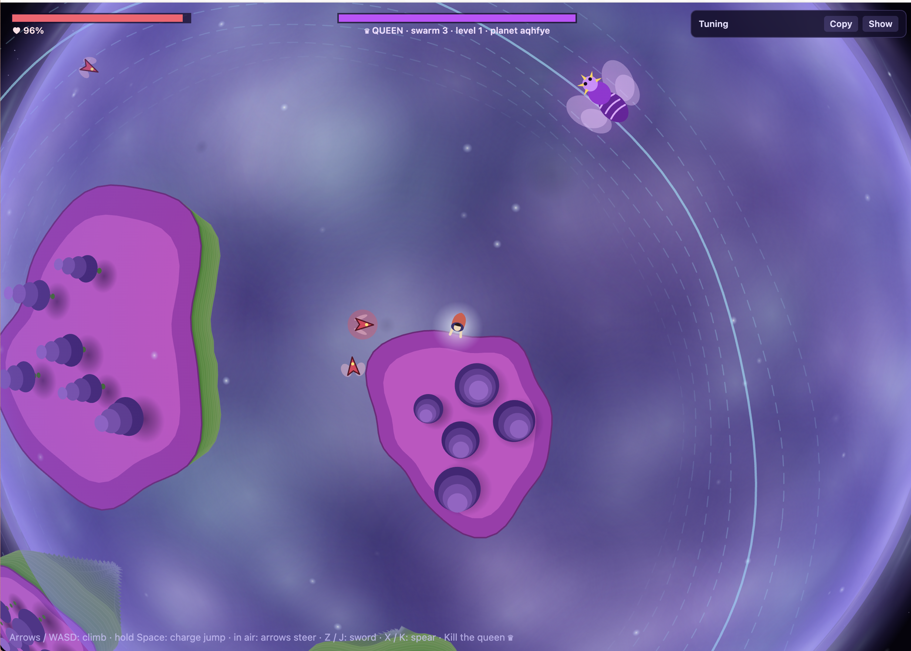

# TinyPlanet Proto 1

A small browser game prototype set on a procedurally generated tiny planet. Climb islands, jump between them, and kill the queen.


## Running

Requires [Bun](https://bun.sh).

```sh
bun install
bun run dev        # dev server with hot reload
bun run build      # production build to dist/
bun run typecheck
```

### Dev panel

The **Dev** box in the top-right corner (click it to show or hide) has two sections:

- **Run** holds runtime-only settings: what to play. These are never copied into source; they're
  saved in your browser, so a reload starts the same run again.
  - **Normal run** plays the game: pick the level to start from, and optionally one template to
    use on every level.
  - **Custom level** sets up a level to test. Start from **Empty** or **Load** any game template
    (resolved as on the level you pick; loading again rerolls its sampled flocks), then edit
    everything: layout, size, where flocks spawn, weapons, modifiers, the queen (her params and
    escort), and the flocks. Add flocks from scratch or from the predefined flock templates. Each
    flock lists its members (type, count, and per-group param overrides; a blank param uses the
    type's default) and its style. Without a queen you win by killing every boid; clearing a
    custom level starts it again. **Copy** gives a flock as a `FlockTemplate` for `flocks.ts`, or
    the whole level as a `LevelTemplate` for `levels.ts`.
- **Tuning** holds the game params as sliders, one tab per group. Changes are saved in the
  browser. **Copy** puts every value on the clipboard as a replacement for `DEFAULTS` in
  `src/params.ts`.

### Enemies, flocks and levels

- **Boid types** live in `src/boids/`, one file per type (melee, ranged, bomber, queen). Each one
  has its default params, its behaviour, its sprite and its briefing card. A boid is an instance
  of a type with param overrides, so a level can field, say, bigger and tougher melee boids
  without a new type. The sprite scales with the `size` param.
- **Flocks** (`src/flocks.ts`) list their members, or sample them by weight to a size range. A
  flock has a style: spread, spacing, tightness, coordination, restlessness, roaming pace, aggro
  and give-up ranges, grudge, and whether it hunts you from the start. Members flock with the
  boids rules, pulled toward the whole flock and leashed past its spread, so a flock stays
  together. When the queen's guard thins out, the nearest whole flock comes to guard her.
- **Level templates** (`src/levels.ts`) give a layout and size, flocks every planet has, and a
  pool of flock templates to spend the rest of the level's swarm budget on (each boid type has a
  budget cost). A template on a level resolves to a `LevelSpec`, the plain data a planet is
  generated from. Custom levels edit a `LevelSpec` directly.

## Controls

| Key | Action |
| --- | --- |
| Arrows / WASD | Climb; steer, speed up and brake while airborne |
| Space | Jump at once (hold for full height); press again in the air to double jump |
| Z / J | Sword |
| X / K | Spear (from level 3) |
| M | Mute / unmute sound |
| I | Switch input mode: keyboard only / keyboard + mouse / gamepad |
| Esc | Pause and show the controls |

Each level opens with a briefing: pick the input mode, and see the controls and enemies for that
level. The first levels introduce things one at a time: level 1 has the sword and a small queen
flock of melee boids, level 2 adds ranged boids, and level 3 adds the spear and bombers. From level
4 on everything is unlocked and the swarm grows each level.

In keyboard + mouse mode, movement (climbing, air steering) stays on the arrows / WASD, but all
aiming follows the cursor: jumps launch toward it, double jumps snap to an island in a narrow cone toward it, and
attacks point at it. Left click attacks with the sword and right click with the spear (Z / X still
work too). The mode is remembered between sessions.

Gamepad mode works like keyboard mode, with the left stick or d-pad in place of the arrows. The
stick is analog: a partly pushed stick climbs, steers and speeds up less. A jumps (the bottom face
button on Xbox, the right one on Switch), B or the right trigger is the sword, the left face button
(X on Xbox, Y on Switch) or the left trigger is the spear, Start / + pauses and Back / − mutes. The
briefing shows the letters printed on the pad in use. Using a pad switches to gamepad mode. Pads the
browser doesn't map itself need a profile in `src/gamepad.ts` (PowerA pads have one). Where the
browser supports it (Chromium), the pad rumbles on hits, blasts, hard landings and full charges.

Every flight has one double jump; it heads where you aim (the cursor, or the direction held; else along the flight). If that misses every island, it snaps to the edge of an island in a 30° cone around the aim. Air speed and height are capped. Hitting an enemy while airborne refills it (max one) and regains
focus; a sword hit also bounces you up. Slow motion while winding up an air attack drains focus; grabbing a rim refills
it. The first dip below the rim in a flight springs you back up once.

Game parameters can be tweaked live from the Tuning section of the dev panel (defaults in `src/params.ts`).
